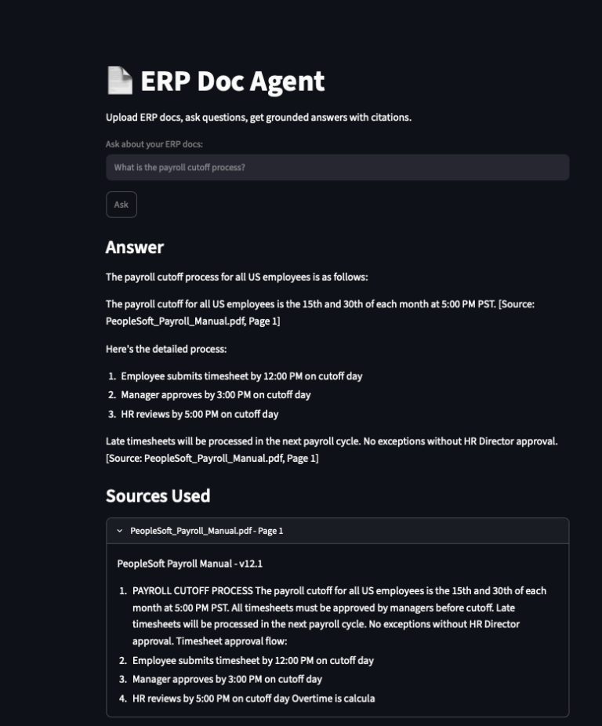
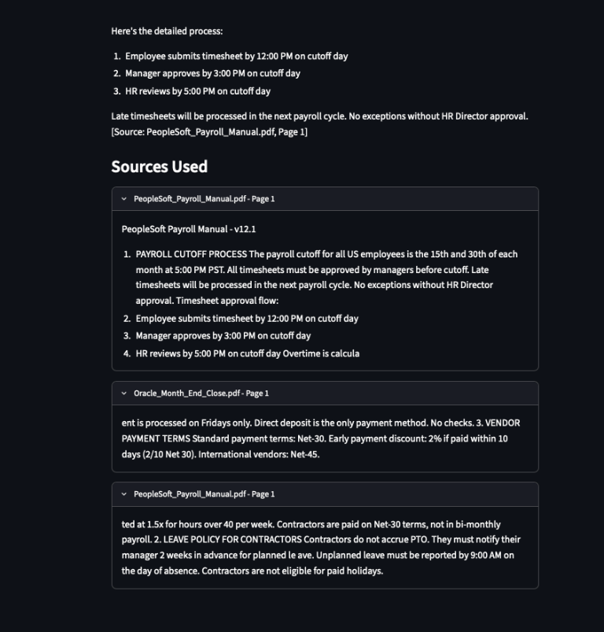

# ERP Doc Agent

Upload ERP docs -> Ask questions -> Get grounded answers with citations.

**Live Demo:** [Add link after deploy]

## Screenshot





## Why?

ERP docs are 500+ pages. Employees waste weeks searching. This agent answers in seconds, with source.

## Tech

- FAISS + TF-IDF for retrieval (no Torch, runs locally)
- Ollama Llama 3.1 8B for generation (no API key, private)
- Streamlit UI
- Python

## How to run

```bash
pip install -r requirements.txt
python create_docs.py
python ingest.py
streamlit run app.py
```
